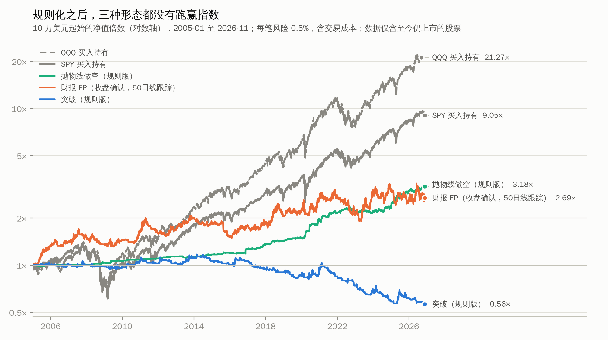
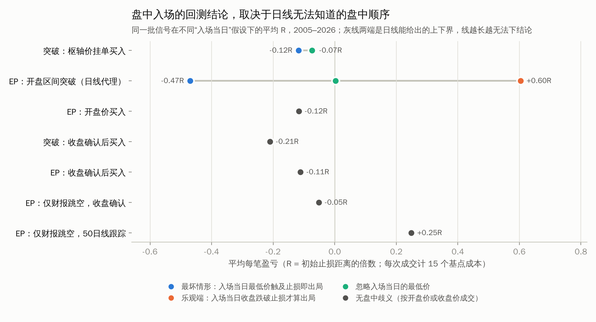
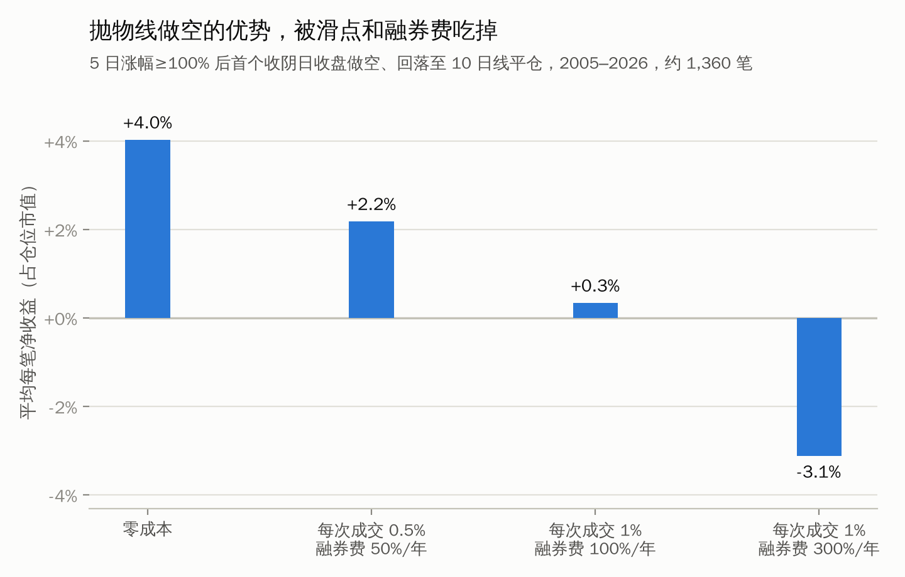

# 机械规则复制不出 Qullamaggie 的收益

我的评价是：Kristjan Kullamägi（网名 Qullamaggie）是一位真实赚到过大钱的主观交易者，但他公开传授的三种形态（Breakout 突破、Episodic Pivot 事件跳空、Parabolic short 抛物线做空）不是一套照做就能赚钱的系统——他的超额收益更可能来自规则没有写下来的部分。钱是真的：瑞典媒体依据公开税务数据刊出的榜单点名他 2021 年收入 3.6 亿克朗（约 4,200 万美元），2020 年另有一条金额吻合但未点名的报道；除此之外，1.05 亿美元的账户峰值、早年动辄数倍的年收益和 2022 年以后的一切都是自述，未经审计，且几个版本互相矛盾。**本次独立回测**（2005–2026 年、约 7,500 只美股、日线、含成本；经独立代码审查并修正后重跑）发现：按他的口径筛出的“领涨股”此后 20 个交易日平均跑输 SPY（标普 500 ETF）1.1 个百分点；机械执行的突破 1,478 笔平均每笔在 −0.12R 到 −0.07R 之间（R 即 R-multiple，以初始止损距离为单位的盈亏；区间两端是对入场当日盘中走势的最坏假设和最乐观假设），27 个变体无一显著为正，与在同一批股票上随机择日买入（−0.07R）没有区别；10% 以上的跳空里只有财报跳空不亏，且只有改用 50 日均线宽松持有才转正（每笔 +0.25R，按月聚类 t = 2.5，在含退市股票的数据上是 2.1；组合年化 4.6%，同期 SPY 为 10.6%，因子 alpha 为零）；抛物线做空是唯一毛优势显著的信号（聚类 t = 5.1），但滑点翻倍、融券费升到年化 100%–150% 之后，优势减半乃至归零，轧空时单笔可以亏掉数倍仓位。学术文献与几项第三方回测指向同一处：三种形态背后的异象都真实存在，但量级只有每月 0.2%–1.5%（毛），发表后多已衰减过半，撑不起三位数的年收益。所以他的钱更可能来自四样东西的叠加：主观选股（他自称放弃约八成“合格”形态）、盘中入场配极窄止损、高集中度加杠杆，以及 2020–2021 年的行情——据第三方整理的税务数据，他 2014–2021 年的已实现利润约 94% 出自这两年，而按他自己对书作者的讲述，随后八个月回吐了约 6,000 万美元。回测的边界必须说清：回测显示没有优势的，是“在日线上机械执行的规则”；他本人盘中的主观交易没有、也无法用现有数据检验。对想学的人，值得带走的是风控骨架而不是信号，照规则做的合理预期是扣成本后持平或小亏，并长期跑输指数。

*证据标记（资料截至 2026 年 11 月 19 日）：未加标记的事实，是本次直接读到原文、原始数据或自行计算的；〔摘要〕表示只见于搜索引擎返回的页面摘要、原页面未能打开；〔记忆〕表示研究员凭记忆引用、本次未核对原文的论文数字。*

## 三种形态共用一副骨架：只做最强的 1–2%，当日低点止损，靠少数大赢家

Qullamaggie 的方法可以压成一句话：只在全市场最强的一小撮高波动美股里，等一个有明确触发点的时刻买入，把止损放在当天的最低价，让少数大赢家覆盖多数小亏损。下面的规则引自他本人的博客和直播——博客原站在本次研究环境里打不开，文本取自两份逐字一致的 GitHub 镜像；直播引语来自 360 场直播的语音转写语料，个别数字可能有转写误差（[博客镜像](https://github.com/Sensible-Analytics/stock_scanner/tree/master/website/extracted_text/qullamaggie.com)；[转写语料](https://github.com/peterdmv/qullamaggie-mcp)）。

选股池是“动量领涨股”：过去 1、3、6 个月涨幅排在全市场前 1–2% 的股票（[博客《3 TIMELESS setups》](https://qullamaggie.com/my-3-timeless-setups-that-have-made-me-tens-of-millions/)）。他自己在看盘软件 TC2000 里实际用的扫描线宽一些：涨幅用收盘价除以区间内最低价来量，取排名前约 7%，再叠加 ADR（Average Daily Range，20 日平均日内振幅，公式为 100×(20 日 High/Low 的均值 − 1)）下限和日成交额下限。2020 年他自己用 ADR 3.5%–4%、成交额 6,000–8,000 万美元，建议小账户用 ADR 5%–6%、成交额 500–1,000 万美元以上（[FAQ](https://qullamaggie.com/faq/)；[2020-08-05 直播](https://www.youtube.com/watch?v=YYFwzNZkRDI)）。扫描只是撒网，每个周期不超过五六十只；最终买哪只是人工挑的。

三种形态都建在这个池子上。**Breakout（突破）**：股票先在几天到几周内涨 30%–100% 以上，再用 2 周到 2 个月横向收敛——低点逐步抬高、振幅收窄、贴着上行的 10 日和 20 日均线“冲浪”——然后在突破当天买入 opening-range high（开盘区间高点，即开盘后第一根 1 分钟、5 分钟或 9:30–10:00 那根 K 线的高点）。止损“永远”放在当日最低价，宽度不得超过 1 倍 ADR，他自己偏好三分之一到一半；3–5 天后卖出三分之一到一半并把止损移到成本价，余仓在首次**收盘**跌破 10 日或 20 日均线时离场。**Episodic Pivot（EP，由意外消息触发的跳空）**：因财报、业绩指引等意外利好跳空高开 10% 以上，开盘前后成交量巨大（最好的那些在开盘后 15–30 分钟就成交掉平日一整天的量），最好此前 3–6 个月没怎么涨过；入场和止损同上，止损最宽 1–1.5 倍 ADR。他说这个形态学自 Pradeep Bonde（Stockbee）。**Parabolic short（抛物线做空）**：大盘股在几天到几周内涨 50%–100% 以上、小盘股涨 300%–1,000% 以上且连涨 3–5 天之后，等盘中第一次走弱（跌破开盘区间低点、冲高后的第一根 5 分钟阴线，或反抽 VWAP 即成交量加权均价失败）再做空，止损在当日最高价，目标是回落到 10 日、20 日均线一带。这个形态学自 Tim Sykes；他自己写道“我最大的亏损通常出在做空上”，并在直播里劝没赚到几百万美元的人不要碰（[《3 TIMELESS setups》](https://qullamaggie.com/my-3-timeless-setups-that-have-made-me-tens-of-millions/)；[《How to master a setup: Episodic Pivots》](https://qullamaggie.com/how-to-master-a-setup-episodic-pivots/)；[FAQ](https://qullamaggie.com/faq/)；[2020-08-06 直播](https://www.youtube.com/watch?v=2f1nX_TGelQ)；[2020-09-02 直播](https://www.youtube.com/watch?v=HUiY2C5jlEQ)）。

风控是这套方法里说得最清楚的部分。每笔交易的风险（入场价到止损的距离乘以股数）通常是账户的 0.25%–1%，“多数时候 0.3%–0.5%”；单只仓位通常占账户 10%–20%，隔夜上限 25%–30%，且不超过该股日均成交量的 1%（[《3 TIMELESS setups》](https://qullamaggie.com/my-3-timeless-setups-that-have-made-me-tens-of-millions/)；[FAQ](https://qullamaggie.com/faq/)）。盈亏用 R-multiple（R 倍数）来数：他自述 2019 年胜率 25%、2020 年约 35%，靠的是赢的那几笔做到 10–20R 乃至更高（[FAQ](https://qullamaggie.com/faq/)；[2021-01-14 直播](https://www.youtube.com/watch?v=n0DsBVg8Spk)）。还有一条大盘过滤器：纳斯达克的 10 日均线在 20 日均线之上且两者都上行时才做突破。他说波段交易者一年的钱主要来自其中三四个月，也承认自己经常不守这条规则（[2020-08-04 直播](https://www.youtube.com/watch?v=WfpvTnScSE8)；[2021-04-07 直播](https://www.youtube.com/watch?v=udNfV6Rt7Xc)；[2020-10-30 直播](https://www.youtube.com/watch?v=1gmFq2IsTYY)）。

读这些规则时有三件事要记住。第一，他明说自己并不按教给别人的方式交易：他在直播里说自己“很大程度上靠直觉”，要求新手机械执行是因为新手还不能信任直觉；他说自己卖出时“每涨 3%–5% 就卖一点”，逢高减仓没有硬规则、全凭感觉；一段由第三方转写、未注明日期的直播片段里，他说自己会放弃约 80% 看上去不错的形态；他也不认为这套方法能被自动化到和主观交易一样好（[2020-08-06 直播](https://www.youtube.com/watch?v=2f1nX_TGelQ)；[2020-08-05 直播](https://www.youtube.com/watch?v=YYFwzNZkRDI)；[2020-07-13 直播](https://www.youtube.com/watch?v=YwMoUTd4naQ)；[片段转写](https://twitter.com/lonextrades/status/1985295796938383809)；[2020-09-16 直播](https://www.youtube.com/watch?v=IhSrnZXH8s4)）。第二，这些形态不是他发明的：突破来自 O'Neil、Minervini、Zanger 一脉，EP 来自 Bonde，抛物线做空来自 Sykes；他在 2026 年出版的 *Market Wizards: The Next Generation* 里说“我什么都没发明”（据 Brett Steenbarger 带页码的转引）（[TraderFeed](https://traderfeed.blogspot.com/2026/06/key-insights-from-latest-market-wizards.html)）。他自己的添加主要在执行和风控：开盘区间入场、当日低点止损、定时减仓、均线跟踪、大盘过滤。第三，几乎所有成文规则都是 2019–2021 年说的，博客自 2021 年 11 月以后没有更新；据 Complete Trader's Edge 对该书第一章的转述，EP “是他现在的主要策略”（[Complete Trader's Edge](https://completetradersedge.com/kristjan-kullamagi-qullamaggie/)）。所以任何“对他的规则”的回测，测的都是他教给新手的骨架，而不是他本人的盈亏过程。

## 钱是真的，但外部证据只覆盖 2020–2021 两年

他赚到过大钱，这一点有他本人左右不了的外部证据。瑞典新闻网站 Nyheter24 依据公开税务数据刊出的“2021 收入年度全国收入最高的 100 人”榜单，第 15 位写着：“Kristjan Kullamägi, 34, Nacka. 360 miljoner. Daytrader.”——3.6 亿瑞典克朗，按当年汇率约合 4,200 万美元（[Nyheter24](https://nyheter24.se/nyheter/ekonomi/1118106-de-tjanade-mest-pengar-2021-bianca-ingrosso-yngst-pa-listan)）。再往前一年，Dagens PS 报道过一位“35 岁上下的股票交易者”以 3.04 亿克朗（约 3,300 万美元）排在 2020 年全国资本收入第 12 位，但没有点名（[Dagens PS](https://www.dagensps.se/bors-finans/han-hade-hogst-lon-i-sverige-168-miljoner/)）；把这个人认作他，依据的是他 2023 年 5 月在 X 上自称“连续两年位列瑞典个人纳税前 15”〔摘要〕（[X](https://twitter.com/Qullamaggie/status/1658863538570420224)）以及金额与下文的税务序列吻合——这是“相符”，不是“证明”。瑞典对资本利得按 30% 课税〔摘要〕（[Wikipedia](https://en.wikipedia.org/wiki/Taxation_in_Sweden)），没有人会为了维持人设多缴上千万美元的税；他也没有卖课程、信号或基金，内容全部免费〔摘要〕（[About](https://qullamaggie.com/about/)）。放在交易圈的“大神”里，这已是罕见的硬证据。

但硬证据只有这两年。其余说法按证据强弱排列如下。

| 说法 | 现有最好的证据 | 判断 |
|---|---|---|
| 2021 年应税收入 3.6 亿克朗（约 4,200 万美元） | 媒体依据公开税务数据刊出的点名榜单，已直接读到 | 已核实 |
| 2020 年收入约 3.04 亿克朗（约 3,300 万美元） | 未点名的媒体报道，金额与身份描述相符；本人自称连续两年纳税前 15 | 很可能属实，身份是推断 |
| 2014–2019 年合计盈利约 500 万美元；2022 年亏损约 2,600 万美元 | 粉丝网站整理的税务序列，未能读到底层数据 | 第三方数据，未核实 |
| 2020 年 1 月 350 万 → 12 月 3,600 万 → 2021 年 11 月 1.05 亿（敞口 1.5 亿）→ 2022 年年中约 4,500 万美元 | 本人向书作者讲述；合著者“审阅过对账单”，不是审计 | 自述；2020 年一段与税务数字相符 |
| 2020 年 8 月 1,700 万 → 12 月底 3,400 万 → 2021 年 3 月 8,200 万美元 | 本人 FAQ 里的账户快照 | 自述 |
| 2013–2018 年每年 +89% 至 +646%（另一版本最高 +1,536%）；2013–2019 年年化 268% | 本人直播、FAQ 与月度日志 | 自述，版本互相矛盾，与美元序列对不上 |
| 约 5,000 美元起步，三四次爆仓 | 本人讲述，至少四个版本 | 自述，无从核实 |
| 2023–2024 年盈利但“一般”；2025–2026 年 | 本人向书作者讲述；此后没有任何数字 | 自述 / 空白 |

粉丝网站 Qullamaggie Deep Dive 称其逐年数字来自瑞典税务资料，代表已实现的应税利润而非账户权益；该站是 JavaScript 应用，本次没能读到底层数据。按它的序列，2014–2019 年每年赚 26 万至 150 万美元、合计约 500 万，2020 年约 3,300 万，2021 年约 4,200 万，2022 年亏约 2,600 万〔摘要〕（[Deep Dive](https://app.qullamaggiedeepdive.com/stats)）。若属实，它同时说明两件事：他从 2014 到 2021 连续八年盈利；以及**这八年约 8,000 万美元的已实现利润里，约 94% 出自 2020–2021 两年**。他自己讲给 *Market Wizards: The Next Generation*（Jack Schwager 与 George Coyle 著，2026）的账户曲线是同一幅图景，本次读到的是 Complete Trader's Edge 对该书第一章的转述：2011 年春以约 5,000 美元起步，三次爆仓，交易近九年后的 2020 年 1 月账户是 350 万美元，同年 12 月 3,600 万，2021 年 11 月到过 1.05 亿——最后 4,000 万只用了约六周，当时多头敞口 1.5 亿美元，约 1.43 倍杠杆——2022 年年中回落到约 4,500 万（[Complete Trader's Edge](https://completetradersedge.com/kristjan-kullamagi-qullamaggie/)）。转述称合著者 Coyle “审阅过原始对账单”，看到的是“一笔接一笔的亏损”；这不是审计，转述方也声明自己没有核查过对账单。

他自报的起点和百分比收益则彼此打架。起始资金至少有四个版本：FAQ 说“2,000 到 5,000 美元，前后三四次”，因为 2011、2012 年爆了很多次；书里是约 5,000 美元，他在直播里说这第一笔钱两个月就亏掉了九成，之后又拿 3,000 美元重来；他的 X 简介写“$3K into $100M”〔摘要〕；流传最广的“9,100 美元”其实是 2013 年 5 月的账户低点，被二手文章当成了起点〔摘要〕（[FAQ](https://qullamaggie.com/faq/)；[2019-10-04 直播](https://www.youtube.com/watch?v=ttKgeB-cZbY)；[X 简介](https://x.com/qullamaggie?lang=en)；[Medium 汇编](https://medium.com/@billyonaire__/i-didnt-ask-for-permission-kristjan-kullam%C3%A4gi-mock-interview-fb3c51509c23)）。年度收益有两套：他在 2019 年 11 月的直播里念的是 2013–2018 年 +352%、+646%、+107%、+217%、+414%、+89%（语音转写）（[2019-11-01 直播](https://www.youtube.com/watch?v=BqGwSzbGS10)），粉丝网站整理的月度日志则是 +783%、+1,536%、+110%、+287%、+1,004%、+96%〔摘要〕（[Deep Dive](https://app.qullamaggiedeepdive.com/stats)）。2019 年他一次说“只赚了 52%”，一次说“好像超过 100%”；2020 年直播说 870%，书里的 350 万到 3,600 万则是 +929%（[2020-06-09 直播](https://www.youtube.com/watch?v=5S-spryFw8Y)；[2020-07-30 直播](https://www.youtube.com/watch?v=TsI1kd_DHTU)；[2021-01-05 直播](https://www.youtube.com/watch?v=yosACutKxAk)）。每笔风险也有出入：他在 2020–2021 年的直播里反复说 0.2%–0.5%、极少超过 1%，合著者 Coyle 在书中却写他“多数交易冒 1% 的风险”（据 Steenbarger 带页码的转引）（[TraderFeed](https://traderfeed.blogspot.com/2026/06/what-we-can-learn-from-market-wizards.html)）。

更要紧的是，这些百分比对不上美元。把日志版的年度收益从 2014 年 1 月的 4.3 万美元账户〔摘要〕连乘下去，2018 年底应有约 1.24 亿美元；而书里 2020 年 1 月的账户是 350 万，税务序列里 2014–2018 年的已实现利润合计只有约 380 万。直播版的数字连乘（2019 年取 52% 或约 110%）折合年化 218%–233%，也对不上 FAQ 里的“2013–2019 年 CAGR（年化复合收益率）268%”。合理的解释是，这些百分比是在一个很小、且不断被取款缴税和支付生活费的本金上算出来的：“2017 年 +1,004%”说的是一个小账户，不是财富的增长速度。美元与税务这两条序列反倒互相对得上：2014–2019 年约 500 万美元利润按 30% 缴税后约 350 万，正是书中 2020 年初的账户规模；2020 年权益增加 3,250 万，对应当年约 3,300 万的应税利润。（本段是研究员用上述数字做的算术。）

2022 年以后，公共记录断了。按书里的讲法，2021 年底大盘见顶、他自己的趋势过滤器翻空，他没有理会，带着激进仓位进入 12 月，并在整个下跌的 2022 年继续买突破和 EP；约 6,000 万美元的回吐里一半是浮盈缩水，其余是大量中小亏损的累积，没有哪一笔是灾难性的。此后 2023、2024 年恢复盈利但收益“一般”，他给自己 2024 年的表现打了 D−（[Complete Trader's Edge](https://completetradersedge.com/kristjan-kullamagi-qullamaggie/)）。他本人 2025 年 10 月在 X 上说，2022 年之后八成交易在 ISK（瑞典的投资储蓄账户；按研究员的背景知识，它不按已实现利润计税，本次未另行查证）里进行，拿税表推断他的业绩“是徒劳的”〔摘要〕（[X](https://x.com/Qullamaggie/status/1978060310880649462)）。也就是说，2014–2021 年还能用的公共记录核查，此后不复存在；2025、2026 年没有任何数字。

追随者的总体结果没有任何数据——没有调查，没有券商或自营公司的统计。能找到的是两位把他列为主要影响的交易者在 U.S. Investing Championship（美国投资锦标赛，成绩由主办方核验的实盘比赛）里的成绩：Marios Stamatoudis 2023 年 +291.2%，Martin Luk 2024 年 +283.1%、2025 年 +969.8%〔摘要〕（[Business Wire 2023](https://businesswire.com/news/home/20240126217806/en/United-States-Investing-Championship-2023-Final-Results)；[Business Wire 2025](https://www.businesswire.com/news/home/20260202090143/en/Multiple-World-Records-Set-in-International-Investing-Competition)）。他们是一个未知分母上的右尾：同一比赛 2026 年上半年的 688 名参赛者里只有 115 人（17%）盈利，而同期标普 500 上涨 10.2%〔摘要〕（[Business Wire 2026](https://www.businesswire.com/news/home/20260728048545/en/United-States-Investing-Championship-First-Half-Results-17-Report-Profits)）。

综合起来，我的判断分四层。“他在 2020–2021 年有约 7,500 万美元的应税收入”可信度高。“2020 年以前他是一位每年稳定赚几十万到一百多万美元的小资金交易者”只有第三方数据支持，但与他自己的讲述一致。“5,000 美元到 1.05 亿”“年化 268%”这类说法无法核实且自相矛盾，不应当作事实引用。2022 年之后是空白。

## 本次独立回测：日线上机械执行的规则没有优势，只有两个带附加条件的例外

税务数据能确认他赚过钱，确认不了钱是不是规则赚的。为了直接检验规则，本次研究自建了一套日线级的规则化回测；全部代码、逐笔交易和日志在仓库的 `backtest/` 目录，下文每个数字都由这套代码在本次会话中算出（[回测说明](../backtest/README.md)；[完整方法与结果](../research_notes/Qullamaggie%20策略评估与回测/own_backtest.md)）。它是本报告里最直接的证据，也有明确的边界，两者都在这一节讲清。

### 测了什么：22 年日线、约 7,500 只美股，逐条对照他的规则

主数据是 Hugging Face 上 `defeatbeta/yahoo-finance-data` 的日线面板：清洗后 7,554 只美股普通股，价格经拆股调整，结果取 2005-01-03 至 2026-11-17。这个面板基本只含幸存股票，而且不均匀：其中 1,158 只中途停止交易，几乎全在 2024–2026 年，约 2024 年以前退市的一概没有。所以另用一份含退市股票的数据（`siddharthmb/stocks-ohlcv`：10,972 只普通股，其中 5,448 只到数据末尾已不再交易；覆盖完整的区间是 2019-07 至 2026-01）把同一套代码重跑了一遍。财报日取自 SEC 的 8-K Item 2.02 申报，共 458,349 条，含已退市公司；基准是含股息的 SPY 和 QQQ（纳斯达克 100 ETF，这份数据里它的序列止于 2026-09-11）（[数据来源说明](../backtest/data_sources.md)）。可交易范围是收盘价不低于 3 美元、20 日均成交额不低于 300 万美元的普通股，平均每天 1,967 只；“领涨股”照他的口径定义为 1、3、6 个月涨幅（收盘价除以区间最低价）任一排进前 2% 且 ADR 不低于 4%，平均每天 63 只。做个合理性检查：这份名单在 2020 年 6 月包含 TSLA、ZM、MRNA、NKLA，2021 年 1 月包含 NIO、PLUG、GME，2023 年 6 月包含 PLTR、SMCI、CVNA，正是他当时直播里在看的股票。成本按多头每次成交 15 个基点（bp；入场、减仓、离场各算一次），空头每次成交 50 个基点另加年化 50% 的融券费。逐条规则的还原程度如下。

| 他的规则 | 回测中的写法 | 还原程度 |
|---|---|---|
| 1/3/6 个月涨幅前 1–2%，ADR 与流动性下限 | 同左（前 7% 作为变体） | 忠实 |
| 2 周至 2 个月的收敛整理，低点抬高，贴 10/20 日线 | 枢轴 = 近 40 日最高价且形成已满 5 日；回撤不超过 5 倍 ADR；近 5 日振幅小于近 20 日；近 5 日低点高于前 5 日；收盘在 20、50 日线上方且 10 日线 > 20 日线 > 50 日线 | 代理（形态规则只是对“看图”的粗糙替代） |
| 突破日买开盘区间高点 | 在枢轴价挂买入止损单，成交价 = max(枢轴价, 开盘价)；高出前收 1 倍 ADR 以上则放弃（他的“不追高”规则） | 代理（日线看不到开盘区间） |
| 止损在当日最低价，不宽于 1 倍 ADR | 止损 = 入场价 − 1 倍 ADR（0.5、1.5 倍为变体）；盘中成交的入场当日按“最坏情形—乐观上界”夹逼 | 代理 |
| 3–5 天后卖 1/3–1/2，止损移到成本价 | 入场后第 3 个交易日起的首个盈利收盘卖 1/3，随后止损 = 入场价 | 忠实 |
| 余仓跟 10 日（或 20 日）线，首次收盘跌破离场 | 收盘跌破均线后的次日开盘卖出 | 忠实 |
| 只在大盘“开”的时候做突破 | QQQ 的 10 日线高于 20 日线且两者上行（2005 年以来占 47% 的交易日） | 忠实 |
| EP：跳空 ≥10%、巨量、买开盘区间高点、止损当日低点 | 三个版本：开盘价买入（日线上精确）；开盘区间代理（只能夹逼）；跳空日成交量 ≥3 倍且收在当日上半区时按收盘价买入、止损为当日低点（限制在 0.25–1.5 倍 ADR 之间） | 开盘版精确，但比他的入场更早、更粗；开盘区间版是代理；收盘版精确，但更晚、更保守 |
| 抛物线做空：连涨后第一次走弱时做空，止损当日高点，目标 10/20 日线 | 5 日涨幅 ≥100%、连涨 ≥3 天、高于 10 日线 ≥30%、当日成交额 ≥1,000 万美元；(a) 次日开盘做空、止损 +30%（日线上精确）；(b) 首个收阴日收盘做空、止损为本轮最高价（限制在入场价上方 5%–100%）；回到 10 日线或满 10 天平仓 | 代理 |
| 主观筛选、题材、催化剂、顺势加仓 | 未编码 | **无法检验** |

有三点影响读数。第一，日线版的止损约为 1 倍 ADR，相当于股价的 8%–9%，比他实际用的当日低点止损宽两到三倍，所以下文的 R 值相对他口中的 R 是被压缩的；每笔的百分比收益可以直接比较。第二，t 值有两种：变体表里的是把每笔交易当作独立样本的朴素 t 值；对几个头条结果，另按入场月份聚类重算了一遍（同一个月入场的交易共享行情，不能算独立），两者并列给出（[聚类 t 值](../backtest/results/clustered_t_hf.txt)）。第三，入场当日的处理分两种：按开盘价成交的交易，当天的全部波动都发生在成交之后，日线算得准；盘中成交的交易不知道当天高点和低点谁先出现，只能给出从“最坏情形”到“乐观上界”的区间，后面有一小节专门讨论。这套回测的初版接受过一次独立代码审查，下文全部是按审查意见修正并重跑之后的数字；审查结论和改动清单见文末“边界”一节。

### 先看总账：最好的多头版本年化 4.6%，同期 SPY 是 10.6%

把信号放进一个真实的账户：10 万美元起始，每笔交易冒账户 0.5% 的风险，按优先级接单直到触及限制——多头单只上限 20%（突破）或 10%（EP）、总敞口上限 100%、最多 20–25 只；空头单只上限 2%、总敞口上限 30%。2005-01-03 至 2026-11-17 的结果如下，各版本的细节在后面几小节拆解。

| 策略 | 年化收益 | 波动率 | Sharpe | 最大回撤 | 期末倍数 | 平均总敞口 |
|---|---|---|---|---|---|---|
| 突破基准版（带大盘过滤；入场当日取乐观上界） | **−2.6%** | 8.1% | −0.50 | −51.8% | 0.56 倍 | 10% |
| 突破基准版，入场当日取最坏情形 | −4.1% | 7.9% | −0.72 | −62.8% | 0.40 倍 | 9% |
| 突破基准版，每笔风险 1%、总敞口上限 140%（他 2020–2021 年的水平） | −5.7% | 15.8% | −0.40 | −78.9% | 0.28 倍 | 19% |
| 财报 EP，收盘入场，他的标准管理 | −2.8% | 7.7% | −0.56 | −50.5% | 0.54 倍 | 17% |
| **财报 EP，收盘入场，50 日线跟踪** | **+4.6%** | 16.6% | 0.25 | −37.4% | 2.69 倍 | 55% |
| 全部 EP，收盘入场，50 日线跟踪 | +2.3% | 25.2% | 0.14 | −66.1% | 1.65 倍 | 71% |
| **抛物线做空（次日开盘、+30% 止损），50 bp + 50% 融券费** | **+5.4%** | 5.1% | 0.72 | −8.5% | 3.18 倍 | 2% |
| 抛物线做空，100 bp + 150% 融券费 | +2.5% | 5.0% | 0.16 | −15.6% | 1.71 倍 | 2% |
| SPY 买入持有（含股息） | 10.6% | 18.9% | 0.54 | −55.2% | 9.05 倍 | 100% |
| QQQ 买入持有（含股息，数据止于 2026-09-11） | 15.1% | 21.6% | 0.68 | −53.4% | 21.27 倍 | 100% |

*图 1：10 万美元起始、每笔风险 0.5%、含成本的净值倍数（主面板）——突破 0.56 倍，财报 EP 加 50 日线 2.69 倍，抛物线做空 3.18 倍，同期 SPY 9.05 倍、QQQ 21.27 倍（QQQ 的数据止于 2026-09-11）。*

三条读数。第一，最好的多头版本也只是一个没有 alpha 的小盘 beta 组合：对市场、规模、价值、动量四因子回归，年化 alpha +0.4%（t = 0.1），市场 beta 0.39、规模因子载荷 0.44；它赚的不到指数的一半，年度起伏却很大——2023 年 +40.1%，2022 年 −23.8%，2015 年 −20.0%，2025 年 −14.6%。第二，机械突破的 alpha 是每年 −4.5%（t = −2.7），而且是在平均只有 10% 资金在场的情况下亏出来的；把风险和敞口加到他 2020–2021 年的水平，结果是年化 −5.7%、回撤 −78.9%。第三，抛物线做空按占用资金算非常漂亮，好年份 2020（+32.8%）和 2025（+24.3%）正好是投机狂热的年份；但要把它放大，需要回测里白送的券源。在含退市股票的数据上（2019-07 至 2026-01）图景相同：突破年化 −3.5%（最坏情形 −5.5%），财报 EP 加 50 日线 +4.4%（因子 alpha −1.1%，t = −0.2），抛物线做空 +9.3%（成本升到 100 个基点加 150% 融券费后只剩 +1.1%），同期 SPY +15.6%、QQQ +20.8%。容量测试也说明问题：给财报 EP 版本加上“单只不超过 20 日均成交额 1%”的限制（他自述的上限），100 万美元账户年化 7.2%，1 亿美元账户只剩 3.1%（[portfolio_log_hf.txt](../backtest/results/portfolio_log_hf.txt)；[portfolio_stats_dolt.csv](../backtest/results/portfolio_stats_dolt.csv)）。**没有任何一个机械版本接近三位数的年收益。**

### 他钓鱼的池子在漏水：领涨股 20 日跑输 SPY 1.1 个百分点

总账为什么是这样，要从选股池说起。不做任何择时、只持有扫描结果会怎样？下表是各组股票此后 20 个交易日相对 SPY 的超额收益（每天对组内股票等权平均；t 值已对重叠窗口做了折减）。

| 组别 | 2005–2026 | 2005–2012 | 2013–2018 | 2019–2021 | 2022–2026 |
|---|---|---|---|---|---|
| 全部可交易股票 | −0.07%（t −0.5） | +0.37% | −0.13% | −0.30% | −0.58% |
| **领涨股（任一周期前 2%，ADR ≥4%）** | **−1.13%（t −2.4）** | −0.06% | −0.68% | −0.93% | **−3.62%（t −3.4）** |
| 其中：1 个月涨幅前 2% | −1.75%（t −3.1） | −0.06% | −1.20% | −2.21% | −5.25%（t −4.2） |
| 放宽到前 7%（他实际的扫描线） | −0.42%（t −1.1） | +0.24% | −0.30% | −0.54% | −1.69%（t −2.2） |
| 学术口径的 12-2 动量前十分位 | +0.16%（t +0.5） | +0.29% | +0.10% | +0.37% | −0.14% |

领涨股在 5 日（−0.30%，t = −2.0）和 60 日（−1.45%；2022–2026 年为 −7.0%）上同样落后；在含退市股票的数据上，2019-07 至 2026-01 的 20 日超额是 −2.55%（t = −2.4）（[universe_log_hf.txt](../backtest/results/universe_log_hf.txt)；[universe_log_dolt.txt](../backtest/results/universe_log_dolt.txt)）。这个结果有独立旁证：一份用 CRSP（学术界标准的美股数据库，含退市股票）做的第三方回测里，被动持有所有通过类似“领涨股”筛选的股票，2016–2026 年年化 −19.2%、最大回撤 −95%（[rootchunhe/martin-luk-backtesting](https://github.com/rootchunhe/martin-luk-backtesting)）。含义很直接：他撒网的那个角落——极端赢家加高波动——正是文献里彩票股效应和短期反转所在的地方，和学术上温和的 12-2 动量（同一份数据里前十分位大致持平）不是一回事。他的方法因此不是“骑动量”，而是“从一个平均会回落的池子里挑出少数还会继续涨的”。这个池子在 2022 年以后看上去更差，这一点在含退市股票的数据上同样成立（2019–2021 年 −1.1%，2022–2026 年 −3.4%）；但上表各年代之间的差距有一部分是假象——主面板缺少 2024 年以前退市的股票，早期年代被美化了。

### 突破信号只换来当天 0.5% 的小涨，此后与随机买入无异

突破信号本身只带来一点点东西。在大盘过滤器打开的 1,520 个信号上，从枢轴价成交到当日收盘平均 +0.50%（中位数 +0.13%，51% 上涨）；到第 5 日相对 SPY 是 −0.44%，到第 20 日是 −1.33%（中位数 −2.96%）。套上他的交易管理之后，结果如下（R 为扣除成本后的净值）。基准版是盘中成交，所以有两行：真实结果落在“最坏情形”和“乐观上界”之间；其后标着“基准版”的变体都按乐观上界口径计算。

| 变体 | 笔数 | 胜率 | 平均 R | t（朴素 / 月聚类） | 平均收益 | 2005–12 | 2013–18 | 2019–21 | 2022–26 |
|---|---|---|---|---|---|---|---|---|---|
| **基准版，乐观上界**：枢轴挂单入场、1 倍 ADR 止损、大盘过滤；入场当日只有收盘跌破止损才算出局 | 1,478 | 43.8% | **−0.070** | −1.9 / −1.6 | −0.51% | +0.02 | −0.07 | −0.04 | −0.17 |
| **基准版，最坏情形**：入场当日最低价触及止损即出局 | 1,479 | 41.5% | **−0.118** | −3.2 / — | −0.88% | −0.03 | −0.13 | −0.09 | −0.20 |
| 收盘确认后买入、当日低点止损（没有盘中歧义） | 918 | 39.7% | −0.210 | −4.0 / −3.8 | −1.19% | −0.34 | −0.22 | −0.14 | −0.15 |
| 基准版，不加大盘过滤 | 2,694 | 45.0% | −0.024 | −0.9 / — | −0.19% | −0.01 | +0.03 | +0.01 | −0.10 |
| 基准版，领涨股放宽到前 7% | 3,666 | 42.3% | −0.082 | −3.4 / — | −0.38% | −0.07 | −0.09 | +0.03 | −0.17 |
| 基准版，只取 10–40 日的整理（27 个变体中最好） | 548 | 43.8% | +0.006 | +0.1 / — | −0.08% | +0.15 | +0.17 | +0.05 | −0.28 |
| 基准版，止损收窄到 0.5 倍 ADR | 1,485 | 32.3% | −0.045 | −0.7 / — | −0.16% | +0.09 | +0.02 | −0.03 | −0.21 |
| 基准版，零成本 | 1,478 | 47.8% | −0.027 | −0.7 / — | −0.21% | +0.08 | −0.02 | +0.00 | −0.14 |
| 基准版，每次成交 50 个基点 | 1,478 | 34.6% | −0.169 | −4.5 / — | −1.20% | −0.10 | −0.18 | −0.12 | −0.25 |
| **对照**：在处于上升趋势的领涨股上随机择日开盘买入，出场规则相同（20 个随机种子，每次约 3,700 笔；开盘成交，日线上精确） | — | 38.3% | **−0.070**（各种子 −0.13 至 +0.01） | — | −0.67% | | | | |

27 个变体（领涨股门槛、动量定义、ADR 与流动性下限、整理的长短深浅、收敛度、缩量、追高限制、止损宽度、减仓比例、是否保本、10 日或 20 日线、成本 0–50 个基点）的平均每笔结果落在 −0.21R 到 +0.01R 之间，没有一个的 t 值超过 +0.1（[breakout_variants.csv](../backtest/results/breakout_variants.csv)）。基准版的真实结果在 −0.12R 到 −0.07R 之间；对照组——在同一批股票上随机挑日子开盘买入、用同样的规则出场——是 −0.07R，正好等于基准版的乐观上界。换句话说，在日线上，“等一个整理形态被突破”这个动作没有增加任何可测的东西。表里分年代的四列要谨慎读：主面板缺少 2024 年以前退市的股票，早期年代被美化，不能把最右一列读成“优势在衰减”（见后面关于幸存者偏差的一小节）。

几个细节值得记下（按乐观上界口径）。平均持仓 5.6 个交易日，约 66% 的交易以止损收场。盈亏形状和他描述的一模一样——多数小亏、少数大赚——只是机械地做，少数不够覆盖多数：基准版合计 −102.8R，其中最好的 14 笔（1%）赚了 +109.6R，其余 1,464 笔合计 −212.5R；最好的几笔是 VKTX（2024 年 2 月，+18.2R、+137%）、EH（2021 年 1 月）、NVAX（2020 年 6 月）、MNKD（2013 年 5 月）、AFRM（2023 年 11 月）这些当年人尽皆知的领涨股（[breakout_log.txt](../backtest/results/breakout_log.txt)）。分年度看，平均每笔为正的年份有 2010（+0.40R）、2013（+0.24R）、2016（+0.14R）、2020（+0.13R）和 2025（+0.12R），最差的是 2011（−0.39R）、2017（−0.33R）和 2022（−0.38R）——与这一派交易者口口相传的好年景、坏年景吻合，说明回测捕捉到的是他们感受到的同一种行情，只是没有他们的利润；截至 11 月中的 2026 年同样很差（−0.39R，44 笔）。大盘过滤器在机械版里没有提高每笔的期望值（开着 −0.07R，关掉 −0.02R），作用只是少出手：2022 年开着过滤器的组合亏 12.0%，关掉亏 20.1%。此外，入场当天的最低价中位数在成交价下方 4.2%，有 62% 的日子比成交价低 0.5 倍 ADR 以上——这就是“当日低点止损”无法用日线还原的原因，后面单独讨论。

### 多数大跳空是陷阱；财报跳空要用 50 日均线才拿得住右尾

EP 分两步看：先看跳空之后的原始收益，再看套上交易管理的结果。事件样本是可交易范围内所有开盘较前收高出 10% 以上的跳空，收益从跳空日**收盘**起算，减去同期 SPY。

| 子集 | 事件数 | 跳空日开盘→收盘 | +5 日 | +20 日 | +60 日 |
|---|---|---|---|---|---|
| 全部跳空 ≥10% | 19,402 | −0.89% | −1.48% | **−3.06%**（t ≈ −5.9） | −2.52% |
| 成交量 ≥3 倍均量且成交额 ≥1,000 万美元 | 11,531 | +0.65% | −1.82% | −3.80%（t ≈ −5.6） | −4.41% |
| 　其中：财报反应日 | 4,737 | +1.28% | −0.19% | **+0.38%**（t ≈ +0.6） | +0.68% |
| 　其中：非财报日 | 6,794 | +0.21% | −2.95% | **−6.68%**（t ≈ −6.7） | −8.00% |
| 　其中：收盘强势（高于开盘价且收在当日上半区） | 4,658 | +10.52% | −1.40% | −2.22%（t ≈ −3.1） | −2.35% |
| 　其中：“被忽视”（此前 6 个月涨跌在 ±30% 以内） | 5,470 | +0.71% | −0.46% | −1.29% | −1.94% |
| 　其中：已大涨（此前 6 个月涨幅 > 50%） | 2,640 | +0.14% | −3.48% | −6.81% | −8.11% |
| 　其中：成交量 ≥10 倍均量 | 2,881 | +2.81% | −4.33% | −8.08% | −12.46% |
| 　其中：跳空 ≥40% | 846 | −3.44% | −6.65% | −15.36% | −17.18% |

单看“放量大跳空”，平均而言是卖出信号，对非财报消息、特大跳空、特大成交量和已经大涨过的股票尤其如此——这个总体里充斥着炒作、增发和一日游式的逼空。财报跳空是例外，但跳空之后的漂移很小（20–60 日不到 1%），统计上与零无法区分；EPS 超预期 20% 以上的子集（2,178 个事件，20 日 +0.61%）也没有更好。他强调的“此前被忽视”确实好于“已大涨”，但仍是负的。按年代，主面板上放量跳空的 20 日超额从 2005–2012 年的 +0.49% 降到 2022–2026 年的 −5.50%，只看财报跳空则是 +1.28%、+1.00%、−0.59%、+0.11%；但这个下降趋势不能照单全收——主面板的早期年代被幸存者偏差美化，而在含退市股票的数据上，2019–2021 年与 2022–2026 年几乎一样（−3.8% 对 −3.6%）（[ep_log.txt](../backtest/results/ep_log.txt)；[ep_log_dolt.txt](../backtest/results/ep_log_dolt.txt)）。下表是交易结果：前六行在跳空日收盘确认强势后买入、以当日低点为止损；最后两行直接在开盘价买入每一个跳空、止损 1 倍 ADR，这种成交方式在日线上是精确的。

| 变体 | 笔数 | 胜率 | 平均 R | t（朴素 / 月聚类） | 平均收益 | 2005–12 | 2013–18 | 2019–21 | 2022–26 |
|---|---|---|---|---|---|---|---|---|---|
| 全部强势跳空，他的标准管理（3–5 日减仓、保本、10 日线） | 4,538 | 41.1% | −0.111 | −5.2 / −3.6 | −1.2% | −0.10 | −0.15 | −0.20 | −0.06 |
| 仅财报跳空，标准管理 | 2,215 | 45.6% | −0.052 | −1.9 / −1.4 | −0.2% | −0.08 | −0.10 | −0.12 | −0.00 |
| 仅财报跳空，改用 20 日线 | 2,214 | 45.3% | −0.015 | −0.5 / — | −0.0% | −0.04 | −0.07 | −0.08 | +0.04 |
| **仅财报跳空，50 日线跟踪、不减仓、不保本** | 2,198 | 25.3% | **+0.248** | +3.1 / **+2.5** | +1.2% | +0.39 | +0.14 | +0.19 | +0.26 |
| 全部强势跳空，50 日线、不减仓、不保本 | 4,482 | 23.6% | +0.153 | +2.3 / — | +0.2% | +0.26 | −0.05 | +0.13 | +0.21 |
| 仅非财报跳空，标准管理 | 2,333 | 36.9% | −0.165 | −5.1 / — | −2.1% | −0.14 | −0.20 | −0.24 | −0.12 |
| **开盘价买入每一个跳空，1 倍 ADR 止损（日线上精确）** | 18,099 | 30.0% | **−0.117** | −8.2 / — | −1.4% | −0.20 | −0.18 | −0.08 | −0.09 |
| 　其中仅财报跳空（精确） | 6,637 | 31.3% | −0.043 | −1.8 / — | −0.3% | −0.03 | −0.08 | +0.01 | −0.05 |

唯一为正的写法是最有耐心的那一种：只做收盘强势的财报跳空，用 50 日均线跟踪，不减仓、不保本。它是一个高度右偏的赌注——25% 的交易盈利，盈利的平均约 +4R。组合实际成交的 1,634 笔里，67% 是差不多完整的 1R 亏损，5.5% 赚到 5R 以上，2.3% 赚到 10R 以上；合计 +322R，而最好的 20 笔就赚了 +410R，去掉它们规则为负。这些大赢家多是这类打法的教科书式案例：NVDA 2016 年 5 月（持有 197 个交易日，+136%、+43.8R）、LULU 2010 年 9 月（+125%）、TSLA 2019 年 10 月（+119%）、AMZN 2007 年 4 月、FSLR 2007 年 2 月、TWLO 2018 年 2 月、AXON 2018 年 2 月、MRVL 2026 年 3 月。反过来，他教给新手的标准管理把同一批入场变成了小亏（−0.05R）：它砍掉的右尾恰恰是全部利润的来源。他的博客确实允许用 20 日或 50 日均线跟踪 EP。需要打的折扣是：这是约 20 个 EP 变体里挑出来的一个，t 值从朴素的 3.1 降到按月聚类的 2.5（在含退市股票的数据上是 +0.33R、3.0 和 2.1），再考虑多重检验，证据只能算中等。至于不加任何筛选、开盘就买，结论是明确的亏损：每笔 −0.12R。

### 日线回答不了盘中入场：同一批信号从 −0.47R 摆到 +0.60R

上面的结果里，有一类是日线算得准的，有一类不是，必须分开看。按开盘价成交的交易——EP 的开盘买入、随机对照、次日开盘做空——当天的全部波动都发生在成交之后，最低价有没有触到止损一目了然；按收盘价成交的交易同样没有歧义。麻烦出在他真正使用的那种入场：盘中某个时刻成交（价格越过枢轴，或越过开盘区间高点），止损放在当日最低价。日线不知道当天的高点和低点谁先出现，只能给出一个区间：下界是最坏情形（当日最低价触及止损就算出局），上界是乐观情形（只有收盘跌破止损才算出局，等于原谅了所有盘中触及止损又收回去的情况）。真实结果在两者之间。

*图 2：两种盘中入场在日线上只能给出区间（突破 −0.12R 至 −0.07R，EP 的开盘区间代理 −0.47R 至 +0.60R）；按开盘价或收盘价成交的五个结果没有盘中歧义，其中“EP 开盘价买入”是 −0.12R。*

对突破的枢轴挂单入场，区间很窄（−0.12R 到 −0.07R），两端都是负的，结论稳健。对 EP，日线上唯一不依赖盘中假设的说法是：在开盘价买入每一个合格的跳空，平均每笔 −0.12R。而用“开盘价上方 0.25 倍 ADR 买入、开盘价下方 0.25 倍 ADR 止损”来近似他的开盘区间突破，同一批约 13,000 个信号的平均结果在最坏情形下是 −0.47R，在乐观上界是 +0.60R（作为参照，完全忽略入场当日最低价的算法约为零）——这个区间比任何说得通的优势都宽（[ep_variants.csv](../backtest/results/ep_variants.csv)）。也就是说，**任何用日线回测他的开盘区间入场的研究——包括网上多数公开的回测——结论都取决于它悄悄选了哪一种假设。** 这不是抽象的担心。本次回测的初版自己就踩过这个坑：把只适用于盘中成交的“收盘判定”用在了开盘成交的 EP 上，得出每笔 +0.08R；独立审查指出后改为精确计算，是 −0.12R。一位花三年给他的规则写代码的作者报告，修正止损位置上的一个前视偏差后，某个扫描器的平均每笔从 +2.42R 变成了 −0.43R〔摘要〕（[What Works in Trading](https://whatworksintrading.substack.com/p/i-spent-three-years-trying-to-teach)）；另一个公开的回测框架在文档里写明，用已完成日线的最低价来定止损和仓位就是前视偏差（[martkling6/qullamaggie-bo-backtester](https://github.com/martkling6/qullamaggie-bo-backtester)）。

### 抛物线做空有真实的毛优势，成本一翻倍就所剩无几

抛物线做空是三者中唯一在盲目执行时有扎实统计优势的。把“抛物线”定义为 5 日涨幅不低于 100%、连涨至少 3 天、高于 10 日均线 30% 以上、当日成交额不低于 1,000 万美元，2005–2026 年共 1,391 个事件；在次日开盘做空、不设止损、不计成本，5 天后平均赚 6.8%，中位数 15.8%，71% 的事件盈利，四个年代全部为正。同一行统计的另一端是：最差的 5 日结果是 −1,701%（[parabolic_log.txt](../backtest/results/parabolic_log.txt)）。

| 变体 | 笔数 | 胜率 | 平均 R | t（朴素 / 月聚类） | 每笔平均收益（占仓位） | 最差一笔 |
|---|---|---|---|---|---|---|
| **次日开盘做空、硬止损 +30%**，回到 10 日线或满 10 天平仓（50 bp + 50% 融券费；开盘成交，日线上精确） | 1,609 | 59.5% | **+0.147** | +5.7 / **+5.1** | **+4.4%** | −112% |
| 　止损放宽到 +50% / +100% | 1,518 / 1,424 | 66.9% / 73.8% | +0.069 / +0.042 | +3.6 / +3.6（朴素） | +3.4% / +4.2% | −161% / −303% |
| 首个收阴日收盘做空、止损为本轮最高价（50 bp + 50% 融券费） | 1,366 | 67.5% | +0.072 | +2.8 / +2.3 | +2.0% | −422% |
| 　零成本、零融券费 | 1,367 | 70.4% | +0.141 | +5.5 / — | +3.8% | |
| 　100 bp + 100% 融券费 | 1,366 | 65.0% | +0.003 | +0.1 / — | +0.1% | |
| 　100 bp + 300% 融券费 | 1,366 | 57.8% | −0.122 | −4.6 / — | −3.3% | |

*图 3：抛物线做空（首个收阴日入场）的每笔净收益随成本假设的变化——零成本 +3.8%，50 个基点加 50% 融券费 +2.0%，100 个基点加 100% 融券费 +0.1%，融券费到 300% 时为 −3.3%。*

问题全在假设能否成立。这些标的绝大多数是微盘股，券源常常借不到，年化 100%–1,000% 的融券费是常态，所以回测里假设的成交很多时候根本拿不到。把成本提高到每次成交 100 个基点、融券费 100%，“首个收阴日”版本的每笔净收益从 +2.0% 掉到 +0.1%，融券费到 300% 时是 −3.3%；“次日开盘”版本在 100 个基点加 150% 融券费下，组合年化从 5.4% 降到 2.5%。左尾是真实的，不是数据错误，最大的几次不利波动已逐根 K 线核对过：QMMM（2025 年 9 月，收盘 11.3 美元，下一个交易日到过 207）、DRUG（2024 年 10 月，2.49 到 38.5）、HKD（2022 年 7–8 月，180 到 1,680）、SAVA（2021 年 2 月，23 到 88）。即使带 30% 的硬止损，最差的一笔也亏掉仓位的 112%，因为价格是跳空越过止损的。每笔的优势也比早年小得多：+30% 止损版四个年代的平均 R 是 +0.32、+0.25、+0.20、+0.09（主面板的年代比较受幸存者偏差干扰，这组数字只宜看方向）；在含退市股票的数据上，2019-07 至 2026-01 是 +0.10R（聚类 t = 2.8）。同时，“首个收阴日”版每年符合条件的交易在 2019 年以前不超过四十笔，2020 年是 184 笔，2025 年是 240 笔。结论是仓位必须极小，这就封住了它对总收益的贡献。

### 幸存者偏差解释不了 2019–2026 年的结论，但会干扰年代之间的比较

主面板基本只含幸存股票，这通常会美化回测。把同一套代码在含 5,448 只已退市股票的数据上、对同一区间（2019-07-01 至 2026-01-28）重跑，对比如下。

| 指标 | 含退市股票 | 仅幸存股票 |
|---|---|---|
| 突破基准版，平均 R：乐观上界 / 最坏情形（笔数） | −0.054 / −0.093（735） | −0.092 / −0.131（677） |
| 收盘确认的突破，平均 R | −0.121（436） | −0.115（399） |
| 随机入场对照，平均 R | −0.046 | −0.005 |
| 放量跳空，+20 日相对 SPY（事件数） | −3.67%（7,594） | −4.43%（6,688） |
| 　财报跳空 | +0.06%（2,640） | −0.12%（2,393） |
| 　非财报跳空 | −5.72%（4,954） | −6.83%（4,295） |
| EP 开盘价买入（精确），平均 R | −0.058（11,808） | −0.060（10,431） |
| EP 收盘买入、标准管理，平均 R | −0.075（2,937） | −0.088（2,551） |
| 财报 EP，标准管理，平均 R | +0.029（1,226） | +0.006（1,121） |
| 财报 EP，50 日线跟踪 | +0.330，t 3.0（聚类 2.1），每笔 +1.6%（1,215） | +0.317，t 2.7，每笔 +1.6%（1,111） |
| 抛物线做空，次日开盘、+30% 止损 | +0.104，t 3.7（聚类 2.8），每笔 +3.1%（1,285） | +0.128，t 4.2，每笔 +3.8%（1,166） |
| 抛物线做空，首个收阴日 | +0.055，每笔 +1.5%（1,103） | +0.072，每笔 +2.0%（992） |

对这类持有几天到几周、带止损的交易，加入退市股票在这个区间里没有改变任何实质结论：差异都在噪声范围内，也没有系统性地偏向幸存者数据。所以用长历史的主面板来判断结果的水平是站得住的；对买入持有类的检验，这个结论不成立。但有一条重要的保留：主面板的幸存者偏差在时间上不均匀——2024 年以后才消失的股票在数据里，更早退市的一概没有。审查实测，在不加大盘过滤的突破里，后来消失的股票在 2019–2021 年平均 −0.38R，一直交易到期末的是 +0.08R。早期年代因此被美化，前面各表的分年代列不能读成“优势在衰减”；各年代的水平如果有偏，也是偏高。含退市股票的数据本身也不完美：有 8 个交易日是空的，少数没有旁证的价格跳变未作调整；审查发现，两个面板里都有的交易，结果有 96%–98% 一致（[回测笔记 §3.5、§4](../research_notes/Qullamaggie%20策略评估与回测/own_backtest.md)；[审查记录](../backtest/AUDIT.md)；[聚类 t 值（含退市数据）](../backtest/results/clustered_t_dolt.txt)）。

### 这个回测能说什么，不能说什么

**它能说的是**：在日线上，把他公开的筛选条件和交易管理不加判断地执行，突破和标准管理的 EP 在 2005–2026 年扣除不高的成本后没有优势；最好的机械多头版本没有因子 alpha；抛物线做空有毛优势，但受制于成本和券源；在含退市股票的数据上，2019–2026 年的图景相同。

**它不能说的是**他本人的交易没有优势。有四样东西没有被检验。一是盘中执行：他的入场在开盘区间高点，止损通常只有 ADR 的三分之一到一半，日线对此无能为力。二是主观判断：他说自己靠直觉、放弃多数形态、要看题材、催化剂和盘口，而回测照单全收每一个信号。三是仓位的动态：顺势加仓、10%–25% 的单只仓位、120%–140% 的总敞口、随行情调节进攻性，回测里只有固定比例的风险。四是券源：做空的可得性和费率是假设的，不是观测的。目前能找到的、最接近“盘中版本”的检验，是下一节那项针对 Martin Luk 规则的研究：扣除价差前每笔约 +0.4%，扣除后约为零。

## 学术文献与第三方回测给出同一个答案：方向成立，量级不够

### 每种形态都踩在一个真实但已衰减的异象上

三种形态各自对应一个被反复验证过的市场异象，这是它们“看起来有道理”的原因；问题出在量级和可得性上。

突破想收割的是横截面动量。这个异象是真实的：Fama-French 的动量因子 UMD 在 1927 年至 2026 年 7 月平均每月 0.62%（t = 4.6），1964–1999 年是 0.89%。但在 2000 年以后的市值加权口径里它已不显著：2000 年 1 月至 2026 年 7 月每月 0.21%（t = 0.7），2009 年以来累计 −28%（[Ken French 动量因子文件](https://github.com/sywon03-prog/Momentum_Project/blob/main/data/raw/F-F_Momentum_Factor.csv)，研究员自行计算）。只做多的人拿到的是多头那条腿：市值加权的赢家十分位相对大盘的超额，1927–2024 年是每月 0.56%，2000 年以后是 0.21%（t = 1.0）（[Ken French 十分位组合](https://github.com/WhitesPhD/momentum-crashes-replication/blob/main/CodeBase/Data/FF_mom_monthly.CSV)）。Open Source Asset Pricing 的复现数据显示，Jegadeesh 与 Titman 的 12 个月动量多空组合从样本内每月 1.35% 降到发表后（1994–2023）的 0.80%（t = 1.7）；与突破最接近的“接近 52 周新高”信号从 0.45% 降到 0.18%（t = 0.6）；用 3 到 1,000 日均线构造的“趋势因子”从 1.63% 降到 0.20%（[OSAP 复现汇总](https://github.com/OpenSourceAP/CrossSection/blob/master/Signals/pyCode/StataComparison/PredictorSummary2024.xlsx)）。至于他交易的那种图形——大涨之后的收敛整理、开盘区间高点入场、当日低点止损——研究员没有找到任何同行评议的检验。动量还高度依赖市场状态：UMD 在大盘此前三年上涨之后平均每月 +0.76%，下跌之后 −0.44%，熊市里的反弹月份 −4.05%；赢家十分位自身在 2021 年 2 月至 2022 年 7 月回撤 43%（[Ken French 动量因子文件](https://github.com/sywon03-prog/Momentum_Project/blob/main/data/raw/F-F_Momentum_Factor.csv)；[Ken French 日频动量文件](https://github.com/z26qin/momentum-tail-risk-monitor/tree/main/data)）。这支持“只在上升趋势里做多”的规则，但不说明趋势的转折可以被择准。

EP 对应的是盈余公告后的价格漂移，这是三者中学术根基最牢的。按公告窗口收益排序的多空组合在 1977–1992 年每月赚 1.15%，发表后的 1997–2023 年仍有 0.85%（t = 7.5）——但这是等权、未扣成本、偏向小微盘的口径（[OSAP 复现汇总](https://github.com/OpenSourceAP/CrossSection/blob/master/Signals/pyCode/StataComparison/PredictorSummary2024.xlsx)）。Martineau（2022）的 “Rest in Peace Post-Earnings Announcement Drift” 认为，非微盘股的漂移 2006 年就已消失〔摘要〕（[Critical Finance Review](https://nowpublishers.com/article/Details/CFR-0122)）；本次回测里财报跳空之后 20 日超额只有 +0.38%，站在“已消失”这一边。Savor（2012）发现，有基本面信息支撑的大幅价格变动之后是漂移，没有信息的之后是反转〔摘要〕（[JFE 2012](https://ideas.repec.org/a/eee/jfinec/v106y2012i3p635-659.html)），与回测里财报跳空（+0.4%）和非财报跳空（−6.7%）的分野一致。

抛物线做空对应短期反转和彩票股效应。上月涨幅最高的十分位在 1991–2023 年平均每月只赚 0.41%，中间十分位约 1.1%；上月单日最大涨幅最高的十分位发表后每月 0.30%，中间约 1.0%–1.25%（[OSAP 复现汇总](https://github.com/OpenSourceAP/CrossSection/blob/master/Signals/pyCode/StataComparison/PredictorSummary2024.xlsx)）。方向没有问题，问题在能不能拿到：Drechsler 与 Drechsler（2014）报告，做空溢价毛值每月 1.43%，扣除融券费后是 0.91%，而且多种异象在融券便宜的八成股票里“基本消失”〔摘要〕（[NBER w20282](https://www.nber.org/papers/w20282)）。文献能预测的是“极端上涨多半没有好下场”，不是“何时见顶”：Greenwood、Shleifer 与 You（2019）对行业层面暴涨的研究结论是，暴涨抬高的是崩盘概率而不是可靠的低收益，价格在见顶前往往还会再涨〔记忆〕（[JFE 2019](https://doi.org/10.1016/j.jfineco.2018.09.002)）。

低胜率本身不说明任何问题。Bessembinder（2018）的 “Do Stocks Outperform Treasury Bills?” 显示，美股历史上约 4% 的公司贡献了超过国债的全部净财富创造〔摘要〕（[ASU 论文页](https://wpcarey.asu.edu/department-finance/faculty-research/do-stocks-outperform-treasury-bills)）；对 1950–2024 年美股做“创历史新高买入、宽幅跟踪止损”的研究同样发现，不到 7% 的交易贡献了利润〔摘要〕（[Concretum](https://concretumgroup.com/does-trend-following-still-work-on-stocks/)）。在这样右偏的分布上做带止损的趋势跟踪，本来就该多数交易亏损、靠少数异常值赚钱；25%–30% 的胜率既不是危险信号，也不是能力的证据。交易者层面的基数则很冷：巴西一项研究中，坚持日内交易超过 300 个交易日的个人有 97% 亏钱〔摘要〕（[SSRN](https://papers.ssrn.com/sol3/papers.cfm?abstract_id=3423101)）；台湾全市场数据的研究（Barber、Lee、Liu 与 Odean，2014）认为，可预测地盈利的日内交易者不到 1%，但这一小撮人的盈利有持续性〔记忆〕（[JFM 2014](https://doi.org/10.1016/j.finmar.2013.05.006)）。文献同时说了两件事：几乎所有人亏钱，极少数赢家会持续赢。Kullamägi 可以是后者之一；仅凭结果，也无法把他同“恰好在 2020–2021 年重仓加杠杆做动量的幸存者”区分开。

文献里唯一强烈为正的“突破”结果，恰好落在本次回测看不到的地方。Zarattini、Barbon 与 Aziz（2024）的工作论文报告，每天只对开盘相对成交量最高的 20 只股票做 5 分钟开盘区间突破、收盘前平仓，2016–2023 年年化 41.6%、Sharpe 2.81（扣佣金）〔摘要〕（[RePEc](https://ideas.repec.org/p/chf/rpseri/rp2498.html)）。这是未经同行评议的八年回测，滑点的处理未能核实，而且不隔夜，说明不了持有数周的结果；但它提示盘中入场这一环可能确有东西。

### 第三方复现出了盈亏的形状，没有复现出收益

质量最高的第三方证据针对的不是他本人，而是风格极近的 2025 年美国投资锦标赛冠军 Martin Luk 的规则：一位匿名作者用含退市股的 CRSP 日线和 TAQ（交易所逐笔成交与报价数据）（2016-01 至 2026-08），按每次成交所在分钟的实际买卖价差计成本（[rootchunhe/martin-luk-backtesting](https://github.com/rootchunhe/martin-luk-backtesting)；研究员直接阅读了仓库，没有重跑）。尾盘确认的回踩入场版本得到 287 笔交易、29% 胜率、平均盈利 +14.3% 对平均亏损 −2.9%，年化 12.1%、Sharpe 0.83、最大回撤 −13%、六因子 alpha 每年 9.6%（t = 2.5）——有统计上站得住的择时优势，但平均只有 8% 的资金在场，同期 QQQ 年化 19.9%。最关键的是，把 Luk 实际使用的早盘入场机械化之后（1,767 笔），每笔平均收益在零滑点下是 +0.40%，按实测价差是 +0.04%，年化 −2.2%：这类股票开盘第一小时的价差是收盘时的 3–8 倍。作者的结论是，规则“至多解释原策略表现的一小部分”，其余在于规则没有包含的东西——选股、交易频率、敞口、何时空仓；入场版本是看着数据选的，所以没有干净的样本外区间。

其余的第三方复现都只见于搜索摘要。Quant for Free 在 1,500 只美股、2015–2026 年上的机械突破：盈利因子 1.03、胜率 37%、最大回撤 −48%，“优势在 10 个基点的成本下消失”，“利润活在十笔交易里”〔摘要〕（[Quant for Free](https://quant4free.com/analysis/qullamaggie-strategy-backtest/)；[压力测试篇](https://quant4free.com/analysis/qullamaggie-strategy-stress-test/)）。Investor Club Research 的结论是突破在日线上扣不扣成本都没有优势，EP 在成本前有约 +0.15 至 +0.20R 的小优势〔摘要〕（[Investor Club Research](https://investorclubresearch.substack.com/p/i-tried-to-trade-like-qullamaggie)）——与本次回测里全部跳空用 50 日线持有的 +0.153R 量级相当。唯一明显乐观的是 Niv Goren 的 Stonks Capital 系列：抛物线做空年化 27.7%、过滤后的财报 EP 年化 30%、合并年化 64%〔摘要〕（[Stonks Capital 第三篇](https://stonkscapital.substack.com/p/modeling-kullamagi-part-3-episodic)；[第二篇](https://stonkscapital.substack.com/p/modeling-kullamagi-part-2-momentum)）。但它的成本假设没有披露，部分规则不公开，作者还因为原规则“表现不好”而放宽了止损、换了出场方式，属于样本内调参；而他的基线——财报日全部买入、20 日线跟踪，5 万个样本——同样是“零优势”。

真金白银的旁证方向一致。把“买入领涨成长股”机械化的 Innovator IBD 50 ETF（FFTY）自 2015 年 4 月成立以来年化约 3%–5%（不同数据源和截止日略有出入），最大回撤 59.5%〔摘要〕（[MyPlanIQ](https://ns2.myplaniq.com/invest/quote/FFTY/)；[ETFRC](https://www.etfrc.com/FFTY)）；做慢速、分散动量的 iShares MSCI USA Momentum Factor ETF（MTUM）则小幅跑赢标普 500（截至 2026 年 4 月的十年年化 14.4% 对 12.4%）〔摘要〕（[PortfoliosLab](https://portfolioslab.com/tools/stock-comparison/IVV/MTUM)），与本次回测里“学术动量持平、领涨股池为负”的对比一致。反过来，锦标赛里的账户证明这种风格在好年份可以做到三位数：Luk 自述的 2025 年是 209 胜 731 负、单只仓位 20%–30%、总敞口最高 280%、全年 900 多笔交易（引自上述仓库对其访谈的整理）。每笔交易的盈亏轮廓与机械版相同，差别在频率和敞口。下表把三类证据并排。

| 形态 | 学术依据 | 本次回测（机械、日线） | 第三方证据 | 判断 |
|---|---|---|---|---|
| 突破 | 动量多头腿 2000 年后每月 +0.21%（t ≈ 1）；该图形本身没有同行评议检验 | 每笔 −0.12R 至 −0.07R，27 个变体无一显著；组合年化 −2.6% | 盈利因子 1.03〔摘要〕；近似规则的盘中入场扣价差后无优势 | 机械版没有优势；若有优势，全在选股和盘中执行 |
| Episodic Pivot | 公告收益漂移发表后仍有每月 0.85%（等权、毛）；非微盘股 2006 年后消失〔摘要〕 | 非财报跳空 −6.7%，财报跳空约为零；开盘买入每笔 −0.12R；50 日线持有 +0.25R，但 alpha 为零 | 成本前 +0.15 至 +0.20R〔摘要〕；调参后年化 30%、成本未披露〔摘要〕 | 三者中根基最牢；机械版只是小盘 beta |
| 抛物线做空 | 短期反转与彩票股效应成立；集中在融券昂贵的股票，扣费后大减〔摘要〕 | 每笔 +4.4%（聚类 t = 5.1）；成本翻倍后减半乃至归零；单笔最差 −112% 至 −422% | 年化 27.7%，融券与成本无法核实〔摘要〕 | 信号真实，但多数人拿不到，也扛不住尾部 |

## 超额收益在规则之外：选股、盘中执行、集中加杠杆，再加上 2020–2021

把证据拼起来，算术上的缺口一目了然。机械规则按他自述的每笔风险执行，得到的是个位数、甚至为负的年化；而一个账户一年翻倍，在每笔风险 0.5% 时需要净赚约 140R，1% 时约 70R。胜率 25%–30% 时，要让每笔期望值达到 0.2–0.5R，盈利交易平均得有 3–5R——研究员查到的同行评议文献里，没有系统策略在扣除成本后有这样的期望值（以上为研究员的算术）。三位数的年收益只能来自规则之外，可以辨认出四个来源。

**第一是选股。** 他自称放弃约八成看上去合格的形态；回测则显示，不挑不拣地持有扫描结果是负期望的，而全部利润集中在极少数交易上——机械突破里最好的 1% 交易赚了 +110R、其余合计 −213R，财报 EP 里最好的 20 笔超过了全部净利润。其中至少有一笔与他自己讲的交易重合：书里提到他 2020 年 2 月把口罩股 APT 当作 EP 买入，而 APT 那次跳空（10 个交易日 +155%、+10.9R）正是机械 EP 回测标准管理版本里最大的赢家之一（[Complete Trader's Edge](https://completetradersedge.com/kristjan-kullamagi-qullamaggie/)；[ep_log.txt](../backtest/results/ep_log.txt)）。所以他的能力——如果是能力——在于事前认出并重仓拿住这几笔，而这正是规则没有写、回测没法测的部分。一个第三方数据站称，在他 828 笔有记录的突破交易里，10 笔（全部出自 2019–2021 年）在一个简单的 10 日出场模型下贡献了 56% 的净收益〔摘要〕（[Market Wizard Study](https://marketwizardstudy.com/)）。

**第二是盘中执行和极窄的止损。** 他说自己的止损通常只有 ADR 的三分之一到一半，并直言关键就是窄止损，这样才做得出 20、30、50 倍的风险回报（[2020-11-12 直播](https://www.youtube.com/watch?v=sgTXnAr2UXs)）。算术上，同样一段 20% 的涨幅，止损 3% 时是 6.7R，止损 8.6%（回测的平均值）时只有 2.3R；同样 0.5% 的风险预算，前者对应 17% 的仓位，后者不到 6%。但窄止损不是白来的：回测里有 62% 的突破日，当天最低价比枢轴成交价低 0.5 倍 ADR 以上，直接把止损收窄到 0.5 倍 ADR 的变体胜率掉到 32%、期望值仍是 −0.05R。要让窄止损成立，入场点必须比“价格越过枢轴”好得多——在盘中低点已经确立之后、紧贴着它买。这是真正的技能所在，也是日线看不见的地方：图 2 里 −0.47R 到 +0.60R 的区间，就是这块未知的大小。现有的两条外部线索方向相反：Luk 规则的盘中机械版扣价差后没有优势，开盘区间突破的工作论文则报告了很高的日内收益〔摘要〕。诚实的结论是不知道。

**第三是集中度、杠杆和频率。** 他自述常规持仓是单只 10%–20%、牛市里 20 到 30 只、多头敞口 120%–140%；按书中说法，峰值时是 1.5 亿美元敞口对 1.05 亿美元权益。他还说账户翻倍后风险和仓位同比例放大，并且只在“配得上”——也就是已有浮盈垫底——的时候才用保证金（[2020-08-03 直播](https://www.youtube.com/watch?v=X9vP9hJY6qM)；[2020-11-20 直播](https://www.youtube.com/watch?v=hY8TKnSNmKM)；[Chat With Traders 第 316 期字幕](https://www.youtube.com/watch?v=sRE0YIh6Pxs)）。这等于把仓位做成了对好行情的凸性押注：越顺越大。对照之下，回测里的机械突破组合平均只有 10% 的资金在场。Luk 的例子是同一个机制：同一套规则的机械版一年 27 笔交易、8% 的资金在场、年化 12%；他本人 2025 年做了 900 多笔、总敞口最高 280%，收益是 +969.8%（[rootchunhe/martin-luk-backtesting](https://github.com/rootchunhe/martin-luk-backtesting)）。

**第四是行情。** 2020 年，市值加权的动量赢家十分位上涨 47.8%，等权的输家十分位上涨 104.5%——几乎所有投机性的东西都在涨（[Ken French 十分位组合](https://github.com/WhitesPhD/momentum-crashes-replication/blob/main/CodeBase/Data/FF_mom_monthly.CSV)）；回测里符合抛物线条件的交易从 2019 年的 27 笔跳到 2020 年的 184 笔，机械突破在 2020 年也是少数为正的年份之一。他把最大的仓位、最高的杠杆带进了这一段，然后带进了它的反面：赢家十分位从 2021 年 2 月到 2022 年 7 月回撤 43%，而按他自己的讲述，账户在八个月里少了约 6,000 万美元。

这是能力还是运气？我的判断是两者先后出场。支持能力的证据：若第三方税务序列属实，他在 2014–2021 年连续八年盈利，其中包括机械突破规则亏损较重的 2015、2017、2018 年（回测平均每笔 −0.24R、−0.33R、−0.15R）——规则亏钱的年份他在赚钱，说明他的利润本来就不是规则给的；合著者审阅对账单时看到的“一笔接一笔的亏损”，也与他自述的低胜率结构相符。支持行情加杠杆的证据（均为自述或第三方数据）：约 94% 的利润出自两年，最后 4,000 万美元六周内到手、八个月内连本带利还回去，此后两年的收益据转述只是“一般”。能力决定了他是一个持续盈利的交易者，行情和杠杆决定了他是一个上亿美元的故事。要估计“这套方法加上他的能力”在普通条件下能产出什么，更好的参照是 2020 年以前——几百万美元本金、每年几十万到一百多万美元——而不是 1.05 亿美元的标题。

### 风险不在单笔而在组合：他自述的权益八个月回落 57%

这套方法的风险不在单笔交易——那是它管得最好的地方——而在组合和行情。行情依赖是结构性的：22 年里机械突破平均每笔为正的只有 8 年（2010、2013、2016、2020、2025 等），他自己也说钱来自一年里的三四个月。至于“他成名之后优势衰减了”这个流行说法，回测只能给出有限的支持。主面板上，机械突破在 2022–2026 年的平均 R 最低（−0.17R 至 −0.20R），放量跳空的 20 日超额也从 2005–2012 年的 +0.5% 降到 −5.5%；但主面板缺少 2024 年以前退市的股票，早期年代被美化，这些年代差距有一部分是假象。站得住的只有一条：领涨股池在含退市股票的数据上同样是 2022 年以后更差（2019–2021 年 −1.1%，2022–2026 年 −3.4%）。放量跳空在含退市股票的数据上看不出变差（2019–2021 年 −3.8%，2022–2026 年 −3.6%）；抛物线做空每笔的优势在主面板上比早年小得多（+0.32R 降到 +0.09R），但同样受这种偏差干扰，只宜看方向。即便是确实变差的部分，数据也说明不了是不是因为拥挤。外部的旁证有两条：2022 年锦标赛的参赛者在第一季度之后只有 18% 盈利〔摘要〕（[Business Wire 2022](https://www.businesswire.com/news/home/20220427005145/en/Top-Traders-Struggle-in-First-Quarter-United-States-Investing-Championship-Results/)）；Bulkowski 对 1991–2008 年约 1.4 万个图形的统计里，2007 年向上突破的失败率是 1991 年的三倍〔摘要〕（[Stocks & Commodities](https://www.traders.com/Documentation/FEEDbk_docs/2009/05/Bulkowski.html)）。

逐笔止损管不住组合回撤。他自述的最大回撤是 2014 年的 50%，常规回撤是“一年几次”的 15%–20%（[FAQ](https://qullamaggie.com/faq/)）；按书里的数字，2021–2022 年账户权益从约 1.05 亿降到约 4,500 万，降幅 57%，其中含多少缴税和提款，来源没有拆分。那一次没有任何一笔灾难性亏损，是浮盈回吐加上大量中小亏损的累积——每一笔都守了止损，组合照样腰斩，因为仓位高度相关、止损后又不断重新入场，而唯一的组合级刹车（大盘过滤器）被他自己关掉了。机械版同样如此：每笔只冒 0.5% 风险的突破组合，最大回撤 −51.8%。他本人的说法是，最好的交易者大部分时间都在回撤里，“这是特性，不是缺陷”（[博客](https://qullamaggie.com/some-good-tweetstorms/)）。

执行成本直接决定盈亏。机械突破（乐观上界口径）在零成本下是 −0.03R，每次成交 15 个基点时 −0.07R，50 个基点时 −0.17R；在只做高流动性股票的 Luk 规则回测里，7% 的交易跳空越过止损，其亏损相当于策略净利润的 18%（[rootchunhe/martin-luk-backtesting](https://github.com/rootchunhe/martin-luk-backtesting)）。做空的尾部是另一个量级：他早年一次做空在第一天就亏掉四分之一本金，也曾花一万美元锁券却没能成交（[2019 年视频](https://www.youtube.com/watch?v=pNWdgezy2VA)；[2019-10-16 直播](https://www.youtube.com/watch?v=MFew0xR3iv0)）。规模是另一重约束：他在直播里对小盘股反复说“对我来说太薄了”，而回测的容量测试里 1 亿美元账户的年化只剩 3.1%。最后是人的问题：这是一种七成以上交易亏钱的打法，Luk 夺冠那年是 209 胜 731 负；而方法的传授者本人，在最关键的时刻没有守住自己最简单的一条规则。

## 对想学的人：能带走的是风控骨架，照做信号的合理预期是跑输指数

先把预期校准到数据上。照规则机械地做突破，22 年的结果是年化 −2.6%、最大回撤 −52%（这还是按入场当日的乐观假设算的）；最好的机械多头版本年化 4.6%，而什么都不做的 SPY 是 10.6%、QQQ 是 15.1%。几项相互独立的第三方复现得到同样的形状。所以起点应该是：**如果你拿不出自己有选股能力的证据，买指数是比照做这套规则更好的选择。**

值得带走的是骨架：入场前就定好止损，按止损距离反推仓位，单只设上限，不向下摊平，亏损快速了结而让盈利的仓位跑。这套东西把单笔错误的代价通常锁在账户的 1% 以内（跳空越过止损时除外），对任何风格都有用。但要补上它缺的一块——组合层面的约束。总的未平仓风险、相关仓位的合计敞口、连续止损后的降档，这些在他的公开规则里都没有成文，而他最贵的一课恰恰出在这里；据对书中内容的转述，他 2022 年之后做的也是在行情停滞时降仓、去杠杆，并写下一套“防自己”的自动规则〔摘要〕（[SnapPChart](https://www.snappchart.app/blog/beginner-playbook/qullamaggie-trading-strategy)；[Excess Returns](https://excessreturnspod.substack.com/p/walk-on-water-five-lessons-from-jack)）。

如果要做，数据给出的筛选方向很具体。跳空里只有财报跳空值得看：非财报的放量跳空 20 日平均跑输 6.7 个百分点，跳空超过 40% 的跑输 15.4 个百分点，成交量放大 10 倍以上的跑输 8.1 个百分点，此前半年已涨过 50% 的跑输 6.8 个百分点；不加筛选、开盘就买每一个跳空，平均每笔 −0.12R。出场要宽：同一批财报跳空，快进快出的标准管理是 −0.05R，50 日均线持有是 +0.25R，差别全在是否留住了平均每年不到一笔的超级赢家。做空不要碰，除非你有稳定且便宜的券源，并且能承受单笔亏掉数倍仓位——他自己也这么劝。成本要量：每次成交多 15 个基点，每笔期望值就少约 0.04R，而这类股票开盘第一小时的价差是收盘时的 3–8 倍，所以先测出自己在开盘时段的真实滑点，比研究任何形态细节都重要。

最重要的是，把“我有没有选股能力”当成一个要用数据回答的问题。做法是记全分母：每天把扫描出来的全部候选记下来，标明哪些做了、哪些放弃了，然后比较三组的结果——你做的、你放弃的、以及随机做的。基准线是现成的：照单全收是 −0.12R 至 −0.07R，随机择日买入是 −0.07R；你挑的交易必须明显高于它。需要的样本量比多数人以为的大：由回测反推，机械突破单笔盈亏的标准差约 1.4R，要在统计上确认 +0.2R 的优势至少要 200 笔左右的交易；右尾更肥的 EP 打法标准差约 3.7R，确认 +0.25R 需要近 900 笔，按每年约 100 个财报 EP 信号算是九年左右（笔者推算）。一两年的盈亏说明不了什么，2020 年那样的年份尤其如此。同样要警惕“只研究大牛股”式的学习：一份公开的事件数据集里，事后手工挑选的 80 个案例一个月后的收益中位数是 +17.7%，而事前收集的全部事件是 −3.4%——事后挑样本把中位数抬高了二十多个百分点（研究员对未经审计的第三方数据的计算）（[stantrader/Episodic-Pivots](https://github.com/stantrader/Episodic-Pivots)）。他本人推荐的“翻遍历史大牛股”的学法有同样的取样偏差，需要用完整的候选清单来对冲。

最后是时间和基数。他自己的说法是，练好 EP 需要三四个财报季（他自己用了七八个），整套方法背后是上千小时的看图；*Market Wizards* 一书对他的描述是十年里每周工作 60–80 小时（据 Steenbarger 转引）（[EP 博文](https://qullamaggie.com/how-to-master-a-setup-episodic-pivots/)；[TraderFeed](https://traderfeed.blogspot.com/2026/06/key-insights-from-latest-market-wizards.html)）。而在愿意公开比成绩的那群人里，2026 年上半年只有 17% 盈利〔摘要〕。本报告是研究分析，不构成针对任何个人的投资建议。

## 这份研究的边界：哪些没能核实，哪些要打折扣

证据方面：研究期间，网页抓取工具打不开绝大多数网站，共享的搜索额度也中途用尽。因此，除后来得以完整读取的三个页面（Nyheter24 的收入榜单、Dagens PS 的报道、Complete Trader's Edge 对书中章节的转述）之外，战绩部分的数字、多数第三方博客回测以及大部分论文的具体数值，只见于搜索摘要或研究员的记忆，文中已分别标为〔摘要〕和〔记忆〕，引用前应对照原文。直接读到或算出的只有：本次回测，基于 Ken French 数据库和 Open Source Asset Pricing 文件的计算，托管在 GitHub 上的第三方回测仓库，他博客的镜像和直播的语音转写，以及 Steenbarger 博文和一期播客字幕的 GitHub 副本。完全没有读到的包括：Schwager 一书的原文及其“业绩与核验流程”附录、瑞典税务局的原始文件、粉丝网站税务序列的底层数据、Reddit 上追随者的长期记录、任何券商对账单，以及他 2024–2026 年的第一手表述。**文中没有任何一个自报的业绩数字经过独立审计**；媒体榜单证实的是 2021 年的应税收入，不是账户权益、收益率或其他年份。

回测方面，除了上文列出的四项未检验内容，还有几点保留。三种形态合计检验了约 60 个变体，孤立的、t 值在 2–3 附近的结果——尤其是财报 EP 加 50 日线——应按多重检验打折。变体表里的 t 值把每笔交易当作独立样本；按入场月份聚类之后，头条结果的结论不变，但显著性普遍下降（例如标准管理的 EP 从 −5.2 降到 −3.6）。平均 R 会给止损窄的交易更高的权重，所以同时报告了百分比收益，并给止损距离设了上下限。主面板的幸存者偏差在时间上不均匀：它包含 2024 年以后才消失的股票，却没有更早退市的，所以早期年代被美化，分年代的比较不可靠，各年代的水平也可能偏高。含退市股票的数据只能验证 2019 年年中以后，更早的年份无法直接验证，而且它自身还有少量残留缺陷（8 个空白交易日、若干没有旁证而未作调整的价格跳变）；主面板在 2026 年年中若干次并股附近的供应商数据故障，也只修复了有旁证的部分。还有一层更根本的保留：这些规则几乎都是在 2019–2021 年那段特殊行情里说出来的，回测检验的是那时定型的规则，而不是一个会随市场调整的交易者。

回测的初版接受了一次独立代码审查，审查者是另一个只拿到代码、看不到结论的分析代理，完整记录见 [AUDIT.md](../backtest/AUDIT.md)。审查没有发现未来函数，也没有发现记账错误：把数据在某一天截断，或把那天之后的数据打乱，此前的信号和交易一笔不变（截断测试比对了 419,300 个信号和 1,343,399 笔交易，扰动测试比对了 208,993 个信号和 669,859 笔交易，差异为零）；审查者独立重写的模拟器逐笔重放了全部 67,967 笔已保存的交易，另加 140,793 笔其他设定下的交易，结果完全一致；21 个结果文件可以逐位复现。信号生成中唯一用到未来信息的环节，是拆股除权日前后各 10 个交易日的隔离窗口，实测影响不超过 0.002R，予以保留并注明（除权日是提前公告的）。审查同时找出八处让个别数字有偏的问题，如下表；除第 8 项无法修正、只能声明之外，其余全部修正后重跑，本报告的回测数字都来自这次重跑。

| # | 初版的问题 | 实测影响 | 本版的处理 |
|---|---|---|---|
| 1 | 把“收盘跌破止损才算出局”的入场日规则用在了开盘价成交的交易上（当天最低价必然出现在成交之后，这在逻辑上不可能），并把它当作折中情形，其实它是乐观上界 | “EP 开盘买入”初版为 +0.08R，精确值是 −0.12R；突破基准版基本不变；随机对照略偏乐观 | 开盘成交一律按精确规则处理；该规则改称乐观上界，盘中入场改报“最坏情形—乐观上界”区间 |
| 2 | 去重规则把同一天止损出局的不同公司当成同一家公司的重复代码删掉，被删的全是亏损单 | 次日开盘做空：主面板 +0.171R 应为 +0.148R，含退市数据 +0.122R 应为 +0.102R | 判重时增加“入场前价格路径相同”的条件，并补了单元测试 |
| 3 | 缺一根 K 线就让均线在其后 10/20/50 行失效，跟踪止盈和趋势过滤被悄悄关闭 | 含退市数据上的财报 EP 加 50 日线：+0.423R 应为 +0.339R | 均线改按窗口内的有效收盘价计算（至少 80% 有效） |
| 4 | 含退市数据的交易日历取自 SPY 的记录：缺 14 个交易日，多 9 个假日行，其中一行让多数股票的 50 日线在 2020 年 2–4 月失效 | 这些日期附近的跳空和均线失真 | 日历改用主面板的；删去假日行；数据源确实缺的 8 天保持空白 |
| 5 | 含退市数据的拆股复权有漏洞：除权日差一天就被拒绝，修复时抹掉了当天的真实涨跌，被重复使用的代码的早期区段没有复权 | 任何一份已保存的交易清单里，受影响的交易不超过 0.5% | 除权日在前后 3 个交易日内搜索；先复权再切分代码；修复比例取自拆股记录 |
| 6 | “缩放故障修复”删掉了一次真实的逼空（TOP Financial，2023 年 4 月），并误处理了部分供应商数据故障 | 两个面板各丢 4 根真实 K 线，另有少量误修 | 修复必须有旁证（比例相符的拆股记录，或成交量的持续下降），否则原样保留 |
| 7 | 含退市数据按代码现在的归属分类，例如 2012–2022 年的 Facebook 因为 FB 如今是一只 ETF 而被整段丢弃 | 至少 16 家流动性好的公司缺失 | 有 SEC 财报申报记录的早期区段予以保留（87 段） |
| 8 | 主面板的幸存者偏差随时间不均匀 | 年代之间的比较受干扰 | 这份数据无法修正，已在上文作为保留意见写明 |

表中“应为”的数值，是审查者在初版数据上单独修正该项后的实测；八项修正叠加、数据重建之后，重跑得到的是正文里的数字（例如次日开盘做空 +0.147R，含退市数据上的财报 EP 加 50 日线 +0.330R）。另有几处影响更小的问题也一并处理：大盘过滤器在 QQQ 数据结束后失效（约 4 笔交易），改用 SPY 接续；止损距离不设限使部分 R 值失去意义，已加上下限；变体表的 t 值不考虑聚类，已为头条结果补上按月聚类的 t 值。对照审查前的初版，变动最大的是四处：次日开盘做空从每笔 +0.17R、占仓位 5.1% 降到 +0.15R、4.4%，组合年化从 6.2% 降到 5.4%；含退市数据上的财报 EP 加 50 日线从 +0.42R 降到 +0.33R，组合年化从 7.0% 降到 4.4%；“EP 开盘买入”原先 −0.12R 至 +0.08R 的区间收敛为精确的 −0.12R；突破基准版从单一的 −0.06R 改为 −0.12R 至 −0.07R 的区间，组合年化从 −2.3% 变为 −2.6%。做空和含退市数据上的财报 EP 这两个正收益的结果都变小了，一个虚假的正收益消失了，没有任何结论改变方向。审查没有核实的是：供应商价格与第三方来源的比对，两个数据面板的完整独立重建，以及融券费、滑点等一切需要盘中数据或实盘数据的内容。修正之后的重跑本身没有再接受一次审查；单元测试（已加入针对两处逻辑修正的用例）全部通过（[test_sim.py](../backtest/src/test_sim.py)），每项变动的方向和大致幅度与审查者的实测一致。

## 结论

这次研究真正改变的不是“他是真是假”的答案，而是这个问题的问法。可以核实的是结果——2021 年确有 3.6 亿克朗的应税收入，2020 年很可能也有相近的数字；可以检验的是规则——而机械执行的规则里没有钱。两者之间的那段距离，就是选股、盘中执行、仓位和行情，能力和运气都住在那里，现有的公开数据分不开它们。所以更准确的说法是：Qullamaggie 公开的不是一个有正期望的策略，而是一个风险容器；容器是免费、清晰、可复制的，往里装什么才决定盈亏，而那一部分既没有成文，也没有被任何人独立检验过。能推翻或坐实这个判断的只有三样东西：用逐笔数据、按“触发前的低点”设止损并计入真实价差的全市场盘中回测；他包含“放弃了哪些”在内的完整交易记录；以及 2022 年之后经得起核查的业绩。

回测里唯一有建设性的发现也指向同一处：机械版中唯一为正的多头写法，恰恰是丢掉了他教给新手的短线管理、单靠耐心持有的那一个，而它 22 年的全部利润来自 20 笔交易。这意味着这门手艺的本质不是“找形态”，而是每年认出并重仓拿住那一两只真正的大牛股，其余几百笔交易只是为此付的学费和保险费。对 2026 年的学习者来说，条件不会比他当年更好：他钓鱼的池子在 2022 年以后漏得更快（含退市股票的数据同样如此），抛物线做空每笔的优势看上去也不如早年，连他本人也转为以 EP 为主，并给自己 2024 年的表现打了 D−。把它当作一套学习风险管理、检验自己判断力的训练框架，以指数为必须战胜的基准，是合理的；把它当作一条已被证明的致富路径，证据不支持。
